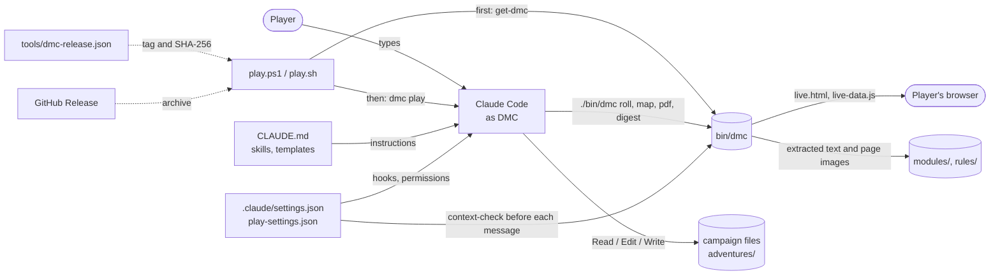

# Architecture

This document is for contributors who want to understand how the parts of the toolkit fit together and what happens on disk during play. The operating rules themselves are in [CLAUDE.md](../CLAUDE.md) and the skills; this document explains them, it does not restate them.

## The parts

| Part | Where | Role |
|---|---|---|
| Operating rules | `CLAUDE.md` | Loaded by Claude Code into every session. Tells Claude it is DMC, the two principles, where each kind of fact lives, when to save, how to handle dice, maps, modules, fights and out-of-character talk. Ends with the git rules for toolkit work. |
| Skills | `.claude/skills/<name>/SKILL.md` | Ten procedures DMC loads when one applies: `new-campaign`, `resume-campaign`, `campaign-full-save`, `update-game-state`, `character-sheet-update`, `draw-map` (with `map-format.md`), `ingest-module`, `setup-rules`, `rewind-campaign`, `review-transcript`. The player can type them as slash commands. |
| Templates | `templates/` | Blank campaign files (`templates/campaign/`), character sheets, the session log, module progress and the general player options. A new campaign is a copy of `templates/campaign/`. |
| Campaign files | `adventures/<campaign>/` | The source of truth for one campaign. The conversation is only a cache of them. Described in [campaign-files.md](campaign-files.md). Ignored by git. |
| Modules and rules | `modules/`, `rules/` | The player's own copies of published adventures (with their digests) and of the rules reference (with its index). Ignored by git. |
| `dmc` | `bin/dmc` (`bin/dmc.exe` on Windows), source in `src/Dmc.Cli/` | One self-contained native program for what a model should not do by itself: `roll`, `map`, `pdf`, `digest`, `context-check`, `play`. Described in [dmc-reference.md](dmc-reference.md). |
| Hooks and permissions | `.claude/settings.json`, `.claude/play-settings.json` | Settings Claude Code applies: the allow list (campaign edits, `./bin/dmc`, `get-dmc`), the compaction hooks, the missing-`dmc` notice, and for play the break reminder, the switched-off tools and the deny rules for shell deletes (`rm`, `Remove-Item` and their aliases), so a play session cannot delete a campaign file through the shell. |
| Launchers | `play.ps1`, `play.sh` | Start a play session: fetch `dmc`, then hand over to `dmc play`, or start Claude Code themselves when `dmc` cannot be had. |
| Installer and pin | `tools/get-dmc.ps1`, `tools/get-dmc.sh`, `tools/dmc-release.json` | Download the pinned `dmc` release for this computer into `bin/`, after checking its SHA-256 against the pin. |
| Release workflow | `.github/workflows/release.yml`, `.github/release/write-pin.sh` | Builds, checks and publishes a release from a `dmc-vX.Y.Z` tag, then opens the pull request that pins it. Described in [releases.md](releases.md). |
| Tests and CI | `tests/Dmc.Tests/`, `.github/workflows/tests.yml` | Check `dmc`, the launchers, `get-dmc`, the settings and the prompts on Windows, Linux and macOS. Described in [development.md](development.md). |

## How they fit

The player talks only to Claude Code. Claude Code, following `CLAUDE.md` and the skills, reads and edits the campaign files with its own Read, Edit and Write tools (never with shell commands, whose long output is cut short), and runs `./bin/dmc` for dice, maps and PDFs. The hooks run `dmc` as well, outside the model's control.

## Starting a session

1. The player runs a launcher. If `tools/dmc-release.json` pins no tag (an empty tag, or no readable file), the launcher neither runs `get-dmc` nor looks at `bin/dmc`: it prints nothing and starts `claude --model sonnet --effort high --settings .claude/play-settings.json` plus the player's arguments itself.
2. If the pin names a tag, the launcher runs `get-dmc`, which does nothing when `bin/dmc --version` already prints the pinned version, and otherwise downloads `<tag>-<rid>.zip` or `.tar.gz` from the GitHub Release, checks its SHA-256, checks that the new program runs and prints that version, and only then moves it into `bin/`.
3. Then, if `bin/dmc --version` runs, the launcher hands over to `bin/dmc play`, which starts that same `claude` command from the toolkit root and waits. If it does not run, the launcher prints one line saying `dmc` is not available and starts the `claude` command itself.
4. Claude Code loads `CLAUDE.md`, `.claude/settings.json` and the play settings. The `SessionStart` hook runs `"$CLAUDE_PROJECT_DIR/bin/dmc" --version`; if that fails it prints one line telling DMC to run `get-dmc` before the first roll, and otherwise prints nothing.
5. Following `CLAUDE.md` § Starting a session, DMC finds the active campaign (`adventures/.active-campaign`) and runs the `resume-campaign` skill: it reads the player options, `game-state.md`, the summary, the DM notes, the sheets of the party, the latest session log and the canon, checks them against each other, and recaps.

## A turn of play

1. The player sends a message. The play settings' `UserPromptSubmit` hook runs `"$CLAUDE_PROJECT_DIR/bin/dmc" context-check 2>/dev/null || true`. Claude Code passes it a JSON object naming the session's log; `dmc` reads the log from the end, finds the latest context size and the baseline (where the context settled before the first player message after the latest compaction, usually the end of the resume's recap) and, from the larger of 150,000 tokens and the baseline plus 40,000, prints one line that Claude Code adds to DMC's context. Below that, and on any error, it prints nothing and exits 0, so it can never block a prompt. The rule is in [dmc-reference.md](dmc-reference.md#context-check).
2. DMC checks the files for anything it is about to state (`CLAUDE.md` § Accuracy and consistency): names and facts in `story/canon.md`, current numbers in `game-state.md`, enemy counts in the Opposition table of `story/dm-notes.md`.
3. If the player must roll, DMC asks in dice notation and stops. If DMC rolls, it runs `./bin/dmc roll` and shows the line.
4. DMC writes what changed before narrating the next beat (`CLAUDE.md` § Saving as you go): any change to the present moment goes into `game-state.md`, each new fact gets one line in `canon.md`, and the character sheet changes if an item or relationship did. In a fight, the combat tracker is brought up to date once per reply, with a single edit that replaces the whole tracker block.
5. In a fight, once per reply, the order is fixed by `CLAUDE.md` § Maps: roll; update `game-state.md` and `maps/live.json` in one edit (positions, and `current`, whose turn comes next); get any distance to be stated from `./bin/dmc map <live.json> --measure A B`, which draws nothing; narrate; run `./bin/dmc map` last, once, only if something on the map changed. The browser picture changes only when a full `dmc map` run rewrites `live-data.js` (the page polls it every two seconds), so drawing last means the map never shows a move before the text has described it.
6. At the end of a scene DMC appends its beats to `story/sessions/session-NNN.md`.

## A full save

`/campaign-full-save` (the `campaign-full-save` skill) is the step that makes a fresh session safe. Its steps, with the skill's own numbers:

| Step | What happens |
|---|---|
| 1. Game state | `game-state.md` is brought to this exact moment, fight included (`update-game-state`). |
| 2. Character sheets | Every character who appeared gets their sheet updated (`character-sheet-update`); bit parts go into `minor-npcs.md`. |
| 3. Session log | Unwritten scenes are appended to the session log. |
| 4. Canon | Missed facts go into `canon.md`, which is then pruned; past about 230 lines, facts whose subject can no longer come up move to `canon-archive.md`. |
| 5. DM notes | `dm-notes.md` is updated, including the Opposition table; closed threads move to `dm-notes-archive.md`. |
| 5a. Module progress | `module-progress.md`, if present, is brought up to date. |
| 6. Summary | `summary.md` is rewritten, under about 600 words. |
| 7. Consistency check | Every file the save changed, and every party sheet, is read again in one batch and checked against the others: HP, resources, inventory, location, time, quests, spellings. |
| 8. Stamp and report | The "Last full save" line is stamped. For a planned break, a line under Pending tells the next resume to restate the immediate situation only. The player is told what the save covers. |

For a planned break, the player is told it is safe to `/clear` only after the consistency check (step 7) has passed, as `CLAUDE.md` § Compaction and long sessions says.

## Compaction

Claude Code may compact a conversation without warning. Two hooks in `.claude/settings.json` cover it: `PreCompact` asks for the summary to keep the campaign name, the scene, the time, the full combat tracker, any pending roll and every unsaved change under a heading UNSAVED CHANGES; `SessionStart` with the `compact` matcher tells DMC to write those changes to the files, rerun `resume-campaign`, and trust the files over the summary.

## Inside `dmc`

`Program.Main` sets up UTF-8 streams with no byte-order mark and LF line ends, and calls `CommandLine.Run`. `CommandLine` handles `--version` and `--help`, finds the subcommand in `CommandTable.All`, runs the stale-binary check (except for commands marked `NeverFails`), and turns every failure into one line, `dmc <command>: <message>`, never a stack trace. Each subcommand is one class in `src/Dmc.Cli/Commands/` that parses its own arguments and calls library code in `Dice/`, `Maps/`, `Pdf/`, `Digest/` or `ContextCheck/`, which the tests also call directly.

`Toolkit.Root` is where `dmc` looks for `tools/`, `adventures/` and the pin: the parent of the program's folder for a player's `bin/dmc`, or the nearest of the three folders above it that holds `tools/dmc-release.json`, for a developer's `artifacts/bin/dmc`.

`dmc` is built with .NET 10 Native AOT for releases, so it starts quickly (the hook runs before every message) and needs no runtime. It uses PdfPig for PDF text, PDFtoImage (PDFium) for page pictures, and Svg.Skia with SkiaSharp for the map PNG, with Liberation Sans embedded so text draws on machines with no fonts. A release is four files: `dmc` and three native libraries (SkiaSharp, HarfBuzzSharp, PDFium).

## Design rules that run through the toolkit

- **The files are the truth.** Everything that matters is written when it happens, so a crash, a compaction or a `/clear` costs at most one exchange.
- **One home per fact.** Each kind of fact has exactly one file (enemy counts in the Opposition table, current HP in `game-state.md`), and each rule has one place in the prompts; other places point to it.
- **What `dmc` prints lands in DMC's context.** Output is short and plain, errors are one line, argument mistakes never print the usage text, and the map format lives in a short separate file DMC reads only when needed.
- **Hooks never get in the way.** `context-check` never fails, and the hook commands swallow a missing program.
- **Play never depends on `dmc` to start.** Without it the launchers still start Claude Code, and DMC can still play and save.
