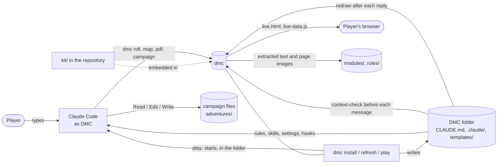

# Architecture

This document is for contributors who want to understand how the parts of the toolkit fit together and what happens on disk during play. The operating rules themselves are in [kit/dm-rules.md](../kit/dm-rules.md) and the skills in `kit/skills/`; this document explains them, it does not restate them.

## The parts

The toolkit is two things that are kept apart: this repository, where DMC is developed, and a **DMC folder** on a player's computer, where it is played. The repository holds the source of everything a DMC folder gets (in `kit/`); `dmc` carries that source inside itself and writes it into the DMC folder.

| Part | Where | Role |
|---|---|---|
| Operating rules | `kit/dm-rules.md`, written as `CLAUDE.md` in a DMC folder | Loaded by Claude Code into every play session. Tells Claude it is DMC, the two principles, where each kind of fact lives, when to save, how to handle dice, maps, modules, fights and out-of-character talk. The repository's own `CLAUDE.md` is different: developer instructions only (the git rules for toolkit work). |
| Skills | `kit/skills/dmc-<name>/SKILL.md`, written as `.claude/skills/dmc-<name>/` | Ten procedures DMC loads when one applies: `dmc-new-campaign`, `dmc-resume-campaign`, `dmc-campaign-full-save`, `dmc-update-game-state`, `dmc-character-sheet-update`, `dmc-draw-map` (with `map-format.md`), `dmc-ingest-module`, `dmc-setup-rules`, `dmc-rewind-campaign`, `dmc-record-feedback`. The player can type them as slash commands. Two more, `review-transcript` and `review-feedback`, stay in the repository's `.claude/skills/` (with Spec Kit's `speckit-*`) and take a DMC folder: they are for working on the toolkit. |
| Templates | `kit/templates/`, written as `templates/` | Blank campaign files (`templates/campaign/`), character sheets, the session log, module progress, the general player options and the feedback entry. A new campaign is a copy of `templates/campaign/`. |
| Settings and hooks | `kit/settings.json`, written as `.claude/settings.json` | Permissions and hooks for play: the allow list (campaign and feedback edits, `dmc`), the deny rules (shell deletes, edits of the generated files, `dmc install`, `dmc refresh` and `dmc update`), the switched-off tools, the compaction hooks, the missing-`dmc` notice, the break reminder, and the Stop hook that redraws the map after each reply. |
| Campaign files | `adventures/<campaign>/` in the DMC folder | The source of truth for one campaign. The conversation is only a cache of them. Described in [campaign-files.md](campaign-files.md). |
| Modules and rules | `modules/`, `rules/` in the DMC folder | The player's own copies of published adventures (with their digests) and of the rules reference (with its index). |
| Feedback | `feedback/` in the DMC folder | One file per piece of feedback about how DMC itself runs the game, written in play by `dmc-record-feedback` (with the `dmc:` version) and by `review-transcript`, read only by `review-feedback`. Outside every campaign; nothing in play loads it. |
| `dmc` | `src/Dmc.Cli/`; installed in `%LOCALAPPDATA%\Programs\dmc` or `~/.local/share/dmc`, on the `PATH` | One self-contained native program: what a model should not do by itself (`roll`, `map`, `redraw`, `pdf`, `digest`, `campaign`, `context-check`), and the commands that make and keep a DMC folder (`install`, `refresh`, `folder`, `play`). The generated files are embedded in it. Described in [dmc-reference.md](dmc-reference.md). |
| The manifest | `.dmc/manifest.json` in the DMC folder | Which files `dmc` wrote, with their SHA-256 and the `dmc` version. The only list of files `dmc` may rewrite or remove; its presence makes a folder a DMC folder. |
| The record of folders | `dmc.json` beside the program | The DMC folders `dmc install` made on this computer, so `dmc play` and `dmc folder` find one from anywhere. |
| Release machinery | `tools/install.ps1`, `tools/install.sh`, `.github/workflows/release.yml`, `.github/release/sign.sh`, `src/Dmc.Cli/Install/ReleaseKeys.cs`, `ReleaseSource.cs`, `Commands/UpdateCommand.cs` | How `dmc` reaches players: a tag builds and checks four archives, the maintainer approves the environment `release`, the checksum list is signed and an immutable release is published; the install line downloads and checks it for the first install, and `dmc update` verifies the signature with the keys built into `dmc` and swaps the program in place. See [releases.md](releases.md). |
| Tests and CI | `tests/Dmc.Tests/`, `.github/workflows/tests.yml` | Check `dmc`, the generated files' source, the settings and the prompts on Windows and Linux. Described in [development.md](development.md). |

### Development and play are apart

| | The repository (development) | A DMC folder (play) |
|---|---|---|
| Rules loaded into a session | `CLAUDE.md`: developer instructions only | `CLAUDE.md`: the Dungeon Master rules, from `kit/dm-rules.md` |
| Skills | `review-feedback`, `review-transcript`, `speckit-*` | the ten `dmc-*` player skills |
| Settings | `.claude/settings.json`: what development needs | `.claude/settings.json`: the play settings, from `kit/settings.json` |
| Changed by | a developer, in a branch | `dmc install`, `dmc refresh`, `dmc play` and `dmc update`, and by nothing else (a session is denied edits to them) |

`kit/` holds the generated files' source under names Claude Code does not load (`dm-rules.md`, not `CLAUDE.md`), so a developer's session in the repository does not pick up the Dungeon Master rules as instructions.

## How they fit

The player talks only to Claude Code. Claude Code, following `CLAUDE.md` and the skills, reads and edits the campaign files with its own Read, Edit and Write tools (never with shell commands, whose long output is cut short), and runs `dmc` for dice, maps and PDFs. The hooks run `dmc` as well, outside the model's control.

## Making and keeping a DMC folder

`dmc install` copies the running program to the program folder (a release build always; a development build only with `--force`), puts it on the user's `Path` (Windows) or links it as `~/.local/bin/dmc` (Linux), and writes the DMC folder by the rules of `Kit/Refresher.cs`: for each file of the fixed table (`kit/dm-rules.md` to `CLAUDE.md`, `kit/settings.json` to `.claude/settings.json`, `kit/skills/**` to `.claude/skills/**`, `kit/templates/**` to `templates/**`), write it if missing, leave it if it is the program's copy, replace it if it is an older generated version (its hash is the manifest's), and otherwise copy it to `.dmc/replaced/<stamp>/` and replace it. Files the program dropped are removed (or moved to `.dmc/replaced/` if edited). The manifest is written last. The one rule (FR-012) is that nothing is written, replaced or removed under `adventures/`, `feedback/`, `modules/`, `rules/` or `exports/`: the table cannot map there, and `GeneratedFiles.Guard` refuses any such path, including one in a damaged manifest. `dmc refresh` does the same for an existing folder; `dmc play` does it before starting Claude Code when the folder is not what this program writes.

Because the generated files are inside `dmc`, a program and its files cannot drift apart, and a change to `kit/` reaches a player only with a new `dmc`.

## Starting a session

1. The player runs `dmc play`. It removes leftovers of an update, finds the DMC folder (the current folder if it is one, else the first recorded in `dmc.json`), and refreshes it if its manifest's version is not this program's or a generated file is missing or differs.
2. It finds Claude Code and starts `claude --model sonnet --effort high` plus the player's arguments in the DMC folder, with this program's folder first on the child's `PATH`. The rules, skills and settings load because the folder is a Claude Code project; no `--settings` is passed.
3. Claude Code loads `CLAUDE.md` and `.claude/settings.json`. The `SessionStart` hook runs `dmc --version`; if that fails it prints one line telling DMC that `dmc` is missing and the player must reinstall, and otherwise prints nothing.
4. Following `CLAUDE.md` § Starting a session, DMC finds the active campaign (`adventures/.active-campaign`) and runs the `dmc-resume-campaign` skill: it reads the player options, `game-state.md`, the summary, the DM notes, the sheets of the PCs, the party and the NPCs present (no others), the latest session log (its last three scenes, or the whole log when the last session ended without a full save) and the canon (whole while it is under about 230 lines; past that, its Rulings, its Prices, debts and promises and the lines a search for the scene's names, places and threads finds), checks them against each other, and recaps.

## A turn of play

1. The player sends a message. The play settings' `UserPromptSubmit` hook runs `dmc context-check 2>/dev/null || true`. Claude Code passes it a JSON object naming the session's log; `dmc` reads the log from the end, finds the latest context size and the baseline (where the context settled before the first player message after the latest compaction, usually the end of the resume's recap) and, from the larger of 150,000 tokens and the baseline plus 40,000, prints one line that Claude Code adds to DMC's context. Below that, and on any error, it prints nothing and exits 0, so it can never block a prompt. The rule is in [dmc-reference.md](dmc-reference.md#context-check).
2. DMC checks the files for anything it is about to state (`CLAUDE.md` § Accuracy and consistency): names and facts in `story/canon.md`, current numbers in `game-state.md`, enemy counts in the Opposition table of `story/dm-notes.md`.
3. If the player must roll, DMC asks in dice notation and stops. If DMC rolls, it runs `dmc roll` and shows the line.
4. DMC writes what changed before narrating the next beat (`CLAUDE.md` § Saving as you go): any change to the present moment goes into `game-state.md`, each new fact gets one line in `canon.md`, and the character sheet changes if an item or relationship did. In a fight, the combat tracker is brought up to date once per reply, with a single edit that replaces the whole tracker block.
5. In a fight, once per reply, `CLAUDE.md` § Maps sets the order: roll; update `game-state.md` and `maps/live.json` in one edit (positions, and `current`, whose turn comes next); get any distance to be stated from `dmc map <live.json> --measure A B`, which draws nothing; write the reply last, with no tool call after it. DMC does not redraw the map itself. The play settings' `Stop` hook runs `dmc redraw` when the reply is finished: if `live.json` has changed since `live-data.js` was written, it draws the page again, so the picture changes after the text that describes the change (when that is the first map of a fight, no page yet or the page showing another map, it also opens `live.html` in the browser, so the first map too comes after the text; it also follows a map DMC drew by hand, which `maps/live-source.txt` names, while `live.json` is unchanged). Claude Code shows reply text after the tool calls that precede it in a turn, which is why the old rule "narrate, then run `dmc map` last" failed in all 6 map updates of the issue #6 Phase 3 play test: DMC wrote no text before the `dmc map` call. A refused file makes the hook exit 2 with one line on stderr, which Claude Code gives to DMC to correct (see [dmc-reference.md](dmc-reference.md#redraw)); `stop_hook_active` stops that from looping, and the next turn reports a file that is still refused. The hook cannot send a picture to a remote player, so for that the order still depends on DMC writing the text first: `dmc-draw-map` has it draw with `--png` and send `live.png` after the reply text. The hook exists only in sessions in a DMC folder (its settings), and only with a `dmc` of release 0.1.3 or later: with an older `dmc` it does nothing and play carries on, and the map is then not redrawn unless DMC runs `dmc map` after its reply text.
6. At the end of a scene DMC appends its beats to `story/sessions/session-NNN.md`.

## A full save

`/dmc-campaign-full-save` (the `dmc-campaign-full-save` skill) is the step that makes a fresh session safe. Its steps, with the skill's own numbers:

| Step | What happens |
|---|---|
| 1. Game state | `game-state.md` is brought to this exact moment, fight included (`dmc-update-game-state`). |
| 2. Character sheets | Every character who appeared gets their sheet updated (`dmc-character-sheet-update`); bit parts go into `minor-npcs.md`. |
| 3. Session log | Unwritten scenes are appended to the session log. |
| 4. Canon | Missed facts go into `canon.md`, which is then pruned. The line count is checked every save: past about 230 lines, facts whose subject can no longer come up move to `canon-archive.md` until it is under about 200, because the resume only reads canon whole under about 230; if every subject is live it stays long and the resume searches it. The Last full save line records the last scene saved. |
| 5. DM notes | `dm-notes.md` is updated, including the Opposition table; closed threads move to `dm-notes-archive.md`. |
| 5a. Module progress | `module-progress.md`, if present, is brought up to date. |
| 6. Summary | `summary.md` is rewritten, under about 600 words. |
| 7. Consistency check | Every file the save changed, and every party sheet, is read again in one batch and checked against the others: HP, resources, inventory, location, time, quests, spellings. |
| 8. Stamp and report | The "Last full save" line is stamped. For a planned break, a line under Pending tells the next resume to restate the immediate situation only. The player is told what the save covers. |

For a planned break, the player is told it is safe to `/clear` only after the consistency check (step 7) has passed, as `CLAUDE.md` § Compaction and long sessions says.

## Compaction

Claude Code may compact a conversation without warning. Two hooks in the DMC folder's `.claude/settings.json` cover it: `PreCompact` asks for the summary to keep the campaign name, the scene, the time, the full combat tracker, any pending roll and every unsaved change under a heading UNSAVED CHANGES; `SessionStart` with the `compact` matcher tells DMC to write those changes to the files, rerun `dmc-resume-campaign`, and trust the files over the summary.

## Inside `dmc`

`Program.Main` sets up UTF-8 streams with no byte-order mark and LF line ends, and calls `CommandLine.Run`. `CommandLine` handles `--version` and `--help`, finds the subcommand in `CommandTable.All`, and turns every failure into one line, `dmc <command>: <message>`, never a stack trace (a command marked `NeverFails`, the hooks', swallows every failure). Each subcommand is one class in `src/Dmc.Cli/Commands/` that parses its own arguments and calls library code in `Dice/`, `Maps/`, `Pdf/`, `Digest/`, `ContextCheck/`, `Kit/` or `Install/`, which the tests also call directly.

`DmcFolder.Find()` is where `dmc` looks for `adventures/` and the Claude Code logs: `CLAUDE_PROJECT_DIR` if it is a DMC folder (a hook), else the current folder if it is one, else the first folder recorded in `dmc.json` that still is; a command that needs one and finds none fails with `no DMC folder: run dmc install`. `Kit/GeneratedFiles` is the table and the guard, `Kit/Manifest` the manifest, `Kit/Refresher` the states above, `Install/ProgramInstall` the program's own install (every machine setting, the home folder, the environment and the Windows user `Path`, is a parameter, so the tests use temporary folders and fakes and never touch the real ones). `dmc install` and `dmc refresh` (and `dmc update`, once it exists) refuse to run when `CLAUDECODE` is set, which Claude Code sets for every command it runs, so a play session cannot change its own rules even through a command a deny rule does not match.

`dmc` is built with .NET 10 Native AOT for releases, so it starts quickly (the hook runs before every message) and needs no runtime. It uses PdfPig for PDF text, PDFtoImage (PDFium) for page pictures, and Svg.Skia with SkiaSharp for the map PNG, with Liberation Sans embedded so text draws on machines with no fonts. A release is four files: `dmc` and three native libraries (SkiaSharp, HarfBuzzSharp, PDFium).

## Design rules that run through the toolkit

- **The files are the truth.** Everything that matters is written when it happens, so a crash, a compaction or a `/clear` costs at most one exchange.
- **One home per fact.** Each kind of fact has exactly one file (enemy counts in the Opposition table, current HP in `game-state.md`), and each rule has one place in the prompts; other places point to it.
- **What `dmc` prints lands in DMC's context.** Output is short and plain, errors are one line, argument mistakes never print the usage text, and the map format lives in a short separate file DMC reads only when needed.
- **Hooks never get in the way.** `context-check` never fails, and the hook commands swallow a missing program. `dmc redraw` fails only for a map file `dmc map` would refuse, with exit 2; its hook command turns every other exit code (an older `dmc` that does not know `redraw`, a missing or broken `dmc`) into a silent exit 0.
- **Play never depends on `dmc` to start.** Without it Claude Code still starts in the DMC folder, and DMC can still play and save.
